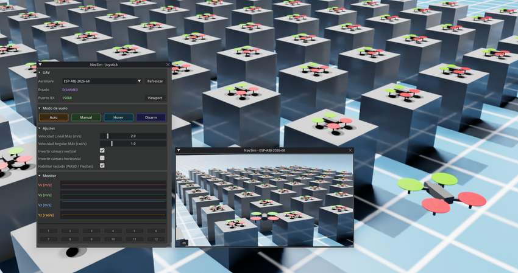
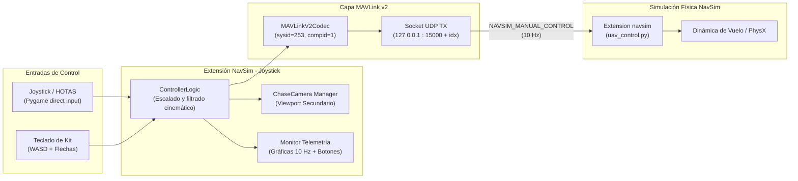
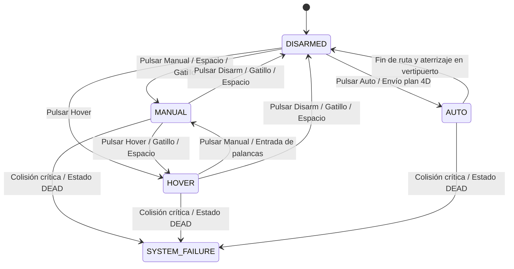
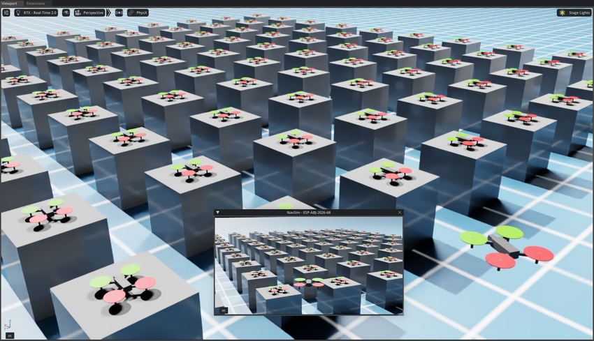
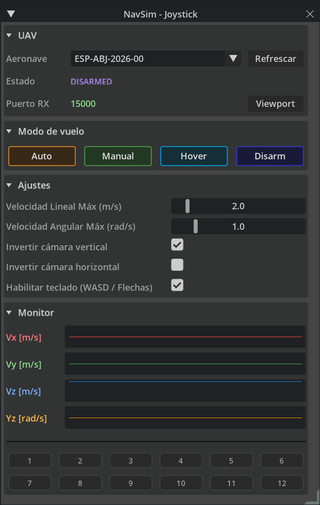
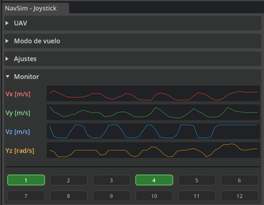

# Extensión NavSim - Joystick (Controlador Manual)

Guía técnica, arquitectura de comunicaciones y manual de usuario de la extensión **`manual_controller`** (**NavSim - Joystick**) en NVIDIA Isaac Sim (Omniverse Kit).

---

## Ficha Técnica

| Parámetro | Detalle |
| :--- | :--- |
| **Identificador del Paquete** | `manual_controller` |
| **Título en Isaac Sim** | `NavSim - Joystick` |
| **Versión** | `2.0.0` |
| **Categoría** | `Simulation` |
| **Desarrollador (UTC)** | Unidad de Transferencia de Conocimiento en Movilidad Aérea Avanzada Mediante Aeronaves No Tripuladas (**UCLM-UAS**) |
| **Protocolo de Comunicaciones** | MAVLink v2 sobre sockets UDP en modo SITL (*Software-In-The-Loop*) |
| **Puerto Base de Recepción** | `15000 + uav_idx` (ej. `15000` para UAV 0, `15001` para UAV 1, ...) |
| **Periféricos Soportados** | Joysticks analógicos / HOTAS / Gamepads (vía Pygame) y Teclado estándar |
| **Gestión de Cámaras** | Cámara de persecución (*ChaseCamera*) en Viewport secundario independiente |

---

## 1. Introducción y Propósito

La extensión **`NavSim - Joystick`** (`manual_controller`) proporciona control cinemático manual y supervisión en tiempo real para aeronaves no tripuladas (UAVs, eVTOLs, aerotaxis y minidrones) dentro del entorno de simulación **NVIDIA Isaac Sim**.

*Figura 1: Entorno de control en NVIDIA Isaac Sim: ventana de control de NavSim - Joystick y visor secundario siguiendo a la aeronave seleccionada (`ESP-ABJ-2026-68`).*

A diferencia de las versiones iniciales basadas en eventos locales de Omniverse, la versión 2.0 opera mediante una arquitectura de red desacoplada:
1. **Comunicaciones estándar MAVLink v2**: Emite consignas de velocidad y modo de vuelo mediante tramas binarias `NAVSIM_MANUAL_CONTROL` dirigidas por UDP a la capa de dinámica física vectorizada de NavSim.
2. **Descubrimiento automático de la flota**: Reconoce de forma dinámica cualquier dron presente en el Stage de OpenUSD sin requerir atributos manuales obsoletos (como `NavSim:Manipulable`).
3. **Cámara de seguimiento sin interferencias**: Despliega automáticamente una cámara de persecución (*ChaseCamera*) en un **Viewport secundario exclusivo**, garantizando que el visor principal de trabajo de Isaac Sim permanezca intacto.
4. **Monitorización y diagnóstico en vivo**: Incorpora visualizadores gráficos de velocidad a 10 Hz y una matriz reactiva de comprobación de botones físicos del joystick.

---

## 2. Arquitectura de Comunicaciones (MAVLink v2 sobre UDP)

El pilotaje manual se integra de manera homogénea con la arquitectura *Software-In-The-Loop* (SITL) de NavSim:

- **Dirección y Puertos UDP**: Cada aeronave en la simulación escucha en un puerto UDP propio asignado correlativamente según su índice en la flota:
  $$\text{Puerto RX} = 15000 + \text{uav\_idx}$$
- **Emisor MAVLink**: La extensión se identifica en la red con `sysid = 253` (Ground Control Station / Controller) y `compid = 1`.
- **Frecuencia de Muestreo y Envío**: Las consignas se transmiten a una cadencia constante de **10 Hz** (cada $100\text{ ms}$) mientras el control manual está activo.

### Mensaje `NAVSIM_MANUAL_CONTROL` (ID 12004)

Trama MAVLink v2 de 22 bytes de carga útil (*payload*) diseñada específicamente para el gobierno de aeronaves en NavSim:

| Campo | Tipo C | Unidad / Formato | Descripción |
| :--- | :---: | :---: | :--- |
| **`uav_id_num`** | `uint8_t` | — | Índice numérico del dron en la simulación (`0, 1, 2, ...`). |
| **`mode`** | `uint8_t` | Enum | Modo de operación comandado: `0=DISARM`, `1=MANUAL`, `2=AUTO`, `3=HOVER`. |
| **`vel_x`** | `float` | $\text{m/s}$ | Velocidad lineal longitudinal (eje cuerpo hacia adelante $+X$ / atrás $-X$). |
| **`vel_y`** | `float` | $\text{m/s}$ | Velocidad lineal lateral (eje cuerpo hacia la izquierda $+Y$ / derecha $-Y$). |
| **`vel_z`** | `float` | $\text{m/s}$ | Velocidad lineal vertical (ascenso $+Z$ / descenso $-Z$). |
| **`rot_z`** | `float` | $\text{rad/s}$ | Velocidad angular de guiñada ($\dot{\psi}$, giro izquierda $+$, derecha $-$). |
| **`buttons`** | `uint16_t` | Máscara de bits | Estado de motores y armado (`1` armado/motores activos, `0` desarmado). |

---

## 3. Descubrimiento y Gestión de Aeronaves en OpenUSD

La extensión escanea automáticamente el Stage activo de USD al cargarse una escena o al pulsar el botón **Refrescar**:

1. **Inspección de Prim**: Consulta el registro oficial de NavSim mediante la función `find_navsim_drone_prims(stage)`. De forma secundaria, detecta cualquier prim cuyo nombre inicie por `UAV_`, `uav_`, `dron_` o `Dron_` en la jerarquía `/World/...`.
2. **Resolución del Identificador (`uas_id`)**:
   - Lee prioritariamente el atributo USD personalizado `NavSim:id` (por ejemplo, `ESP-ABJ-2026-00`, `AT-001`, `MINI-01`).
   - En caso de no existir, emplea el nombre del prim USD (por ejemplo, `UAV_0`, `UAM_aerotaxi`).
   - Este identificador se refleja tanto en el selector desplegable como en la barra de título del Viewport secundario.
3. **Cambio Dinámico de Objetivo**: Al seleccionar otra aeronave en el menú desplegable, el sistema reasigna inmediatamente el puerto UDP de destino (`15000 + uav_idx`), traslada la cámara de seguimiento al nuevo dron y actualiza el título del visor secundario.

*Nota:* Ya no es necesario añadir manualmente la propiedad `NavSim:Manipulable` a los prims de la escena. Cualquier modelo de dron instanciado desde la flota de NavSim es reconocido de inmediato.

---

## 4. Máquina de Estados Operativa

La extensión se sincroniza con el estado de vuelo real de la aeronave en la simulación física:

| Estado | Color UI | Código | Comportamiento |
| :--- | :---: | :---: | :--- |
| **`DISARMED`** | Rojo suave (`#E57373`) | `0` | Motores apagados. Consignas en cero. El dron descansa en tierra o vertipuerto. |
| **`MANUAL`** | Verde (`#81C784`) | `1` | Control cinemático activo. Las entradas de palanca/teclado modulan directamente las velocidades del dron. |
| **`AUTO`** | Azul (`#64B5F6`) | `2` | Vuelo autónomo gobernado por un plan de vuelo 4D polinómico recibido por MAVLink. |
| **`HOVER`** | Ámbar (`#FFD54F`) | `3` | Sustentación estática en el aire. El dron conserva su altitud y posición cartesiana sin traslación. |
| **`SYSTEM_FAILURE`**| Rojo intenso (`#FF1744`) | `4` | Fallo estructural o parada de emergencia reportada por el motor de físicas de NavSim. |

---

## 5. Cámara de Persecución (*ChaseCamera*) y Viewport Secundario

La extensión cuenta con un avanzado subsistema de visualización diseñado para no entorpecer el flujo de trabajo en Isaac Sim:

*Figura 2: Viewport secundario flotante e independiente (`NavSim - ESP-ABJ-2026-68`), mostrando la persecución limpia del dron en vuelo mientras el Viewport 1 principal permanece libre.*

- **Viewport Secundario Exclusivo**: Crea una ventana de visor independiente titulada `NavSim - <uas_id>`. El visor principal de Isaac Sim (**Viewport 1**) permanece completamente libre para navegar por el escenario o editar el Stage.
- **Acople Persistente (Docking)**: Utiliza un identificador persistente de ventana (`###NavSim_ChaseCamera_Viewport`), lo que permite anclarla en cualquier cuadrante de la pantalla sin que pierda su disposición al cambiar de dron.
- **Autocalibración según Dimensiones del UAV**: A través del *Bounding Box* del modelo USD, calcula automáticamente la distancia óptima y la altura de seguimiento:
  - **Aerotaxis / UAVs de gran envergadura (> 3 m)**: Distancia focal $\approx 14\text{ m}$ (rango $3.0\text{ m} - 80.0\text{ m}$), altura $3.8\text{ m}$.
  - **Minidrones (< 1 m)**: Distancia focal $\approx 2.0\text{ m}$ (rango $0.4\text{ m} - 15.0\text{ m}$), altura $0.6\text{ m}$.
  - **Drones convencionales (1 a 3 m)**: Escalado geométrico proporcional.
- **Entorno Visual Limpio**: Oculta automáticamente menús superiores (*Menubar*), estadísticas invasivas del HUD (FPS, consumo de VRAM/RAM, resolución) y guías visuales (ejes cartesianos XYZ y cuadrícula), forzando el llenado total del marco (*fill frame*) sin bandas negras.
- **Órbita Esférica y Zoom**: Posibilidad de orbitar 360° en azimut (Yaw), entre $-30^\circ$ y $+60^\circ$ en inclinación (Pitch) y zoom dinámico.
- **Función de Restablecimiento (*Camera Reset*)**: Un toque al botón 2 del joystick o a la tecla `R` / `Numpad 5` devuelve la cámara al punto de seguimiento inicial.

---

## 6. Mapeo de Controles y Periféricos

### A. Joystick / HOTAS / Mandos Analógicos

Diseñado y calibrado de forma nativa para el joystick **Thrustmaster Flight Stick X** (compatible con cualquier periférico DirectInput / HID soportado por Pygame):

| Control Físico | Identificador Pygame | Acción Cinemática / Función | Rango / Parámetro |
| :--- | :---: | :--- | :--- |
| **Eje Longitudinal** (Palanca Adelante / Atrás) | Eje 1 (`Pitch`) | Velocidad lineal hacia adelante ($+V_x$) / atrás ($-V_x$) | $[-V_{\text{max}}, +V_{\text{max}}]$ |
| **Eje Transversal** (Palanca Izquierda / Derecha) | Eje 0 (`Roll`) | Velocidad lateral a izquierda ($+V_y$) / derecha ($-V_y$) | $[-V_{\text{max}}, +V_{\text{max}}]$ |
| **Torsión Z** (Giro de muñeca palanca) | Eje 2 o 3 (`Yaw`) | Velocidad angular de guiñada ($\dot{\psi}$) | $[-\Omega_{\text{max}}, +\Omega_{\text{max}}]$ |
| **Control Deslizante** (Palanca *Throttle* / Slider) | Eje 3 o 2 (`Throttle`)| Velocidad vertical de ascenso ($+V_z$) / descenso ($-V_z$) | $[-V_{\text{max}}, +V_{\text{max}}]$ |
| **Gatillo de Disparo** (Botón 1) | Botón 0 | Conmutar Armado / Estacionario | `HOVER` $\leftrightarrow$ `DISARM` |
| **Botón Superior Pulgar** (Botón 2) | Botón 1 | **Reset de Cámara**: Restablece posición inicial | Yaw = 0°, Pitch = 0°, $d = d_0$ |
| **Botón 5** | Botón 4 | Zoom In (Acercar cámara de seguimiento) | Reduce distancia relativa |
| **Botón 6** | Botón 5 | Zoom Out (Alejar cámara de seguimiento) | Aumenta distancia relativa |
| **Cruceta Hat** (Arriba / Abajo) | Hat 0 (Eje Y) | Elevación orbital de la cámara (Pitch) | $-30^\circ \dots +60^\circ$ |
| **Cruceta Hat** (Izquierda / Derecha) | Hat 0 (Eje X) | Rotación orbital de la cámara (Yaw) | $0^\circ \dots 360^\circ$ continua |
| **Zona Muerta (*Deadzone*)** | Software (0.05) | Supresión de temblores en punto neutro | Umbral $|v| < 0.05 \rightarrow 0.0$ |

### B. Teclado de Computadora (Keyboard)

En caso de no disponer de joystick físico, la extensión incorpora emulación completa por teclado:

| Categoría | Tecla Principal | Tecla Numpad | Acción / Efecto |
| :--- | :---: | :---: | :--- |
| **Desplazamiento Horizontal** | `W` | — | Avanzar longitudinalmente ($+V_x$, aceleración suave) |
| | `S` | — | Retroceder longitudinalmente ($-V_x$) |
| | `A` | — | Desplazamiento lateral a la izquierda ($+V_y$) |
| | `D` | — | Desplazamiento lateral a la derecha ($-V_y$) |
| **Altitud y Rotación** | `Flecha Arriba` | — | Ascender verticalmente ($+V_z$) |
| | `Flecha Abajo` | — | Descender verticalmente ($-V_z$) |
| | `Flecha Izquierda` | — | Guiñada / Giro a la izquierda ($+\dot{\psi}$) |
| | `Flecha Derecha` | — | Guiñada / Giro a la derecha ($-\dot{\psi}$) |
| **Armado / Modos** | `Barra Espaciadora` | — | Conmutar Armado (`HOVER` $\leftrightarrow$ `DISARM`) |
| **Cámara: Órbita** | `I` | `NUMPAD 8` | Inclinar cámara hacia arriba ($+\text{Pitch}$) |
| | `K` | `NUMPAD 2` | Inclinar cámara hacia abajo ($-\text{Pitch}$) |
| | `J` | `NUMPAD 4` | Rotar cámara a la izquierda ($-\text{Yaw}$) |
| | `L` | `NUMPAD 6` | Rotar cámara a la derecha ($+\text{Yaw}$) |
| **Cámara: Zoom** | `Left Control` | `NUMPAD -` (Resta) | Acercar cámara (*Zoom In*) |
| | `Right Control` | `NUMPAD +` (Suma) | Alejar cámara (*Zoom Out*) |
| **Cámara: Reset** | `R` | `NUMPAD 5` | Restablecer cámara a su posición por defecto |

---

## 7. Interfaz Gráfica de Usuario (UI)

La interfaz se estructura en cuatro paneles plegables inspirados en la estética nativa del *Property Window* de Isaac Sim:

*Figura 3: Panel principal de la extensión `NavSim - Joystick` con sus cuatro secciones: UAV, Modo de vuelo, Ajustes y Monitor.*

### 1. Panel «UAV»
- **Aeronave**: Selector desplegable con todas las aeronaves identificadas en el escenario (mostrando su matrícula o identificador legal `uas_id`).
- **Botón «Refrescar»**: Reescanea el árbol USD para incorporar nuevos drones introducidos dinámicamente.
- **Estado**: Indicador tipográfico de color con el modo actual de la aeronave (`DISARMED`, `MANUAL`, `AUTO`, `HOVER`, `SYSTEM_FAILURE`).
- **Puerto RX**: Muestra el puerto UDP de escucha MAVLink asignado al dron (`15000 + idx`).
- **Botón «Viewport»**: Abre o enfoca la ventana secundaria de la cámara de persecución con el título `NavSim - <uas_id>`.

### 2. Panel «Modo de vuelo»
Cuatro botones temáticos de disparo inmediato (*event triggers*):
- **`Manual`** (Verde): Conmuta la máquina de estados a pilotaje manual continuo.
- **`Hover`** (Ámbar): Activa el vuelo estacionario automático.
- **`Auto`** (Azul): Transfiere el control al planificador de misiones autónomas 4D.
- **`Disarm`** (Rojo): Desarma motores y detiene inmediatamente el envío de consignas.

### 3. Panel «Ajustes»
- **Velocidad Lineal Máx (m/s)**: Deslizador de $0.5$ a $15.0\text{ m/s}$ (valor por defecto: $2.0\text{ m/s}$).
- **Velocidad Angular Máx (rad/s)**: Deslizador de $0.2$ a $5.0\text{ rad/s}$ (valor por defecto: $1.0\text{ rad/s}$).
- **Invertir cámara vertical**: Invierte el sentido del eje de cabeceo (Pitch) de la cámara (activado por defecto).
- **Invertir cámara horizontal**: Invierte el sentido del azimut (Yaw) orbital de la cámara.
- **Habilitar teclado (WASD / Flechas)**: Habilita o inhabilita la captura de eventos de teclado de Omniverse Kit.

### 4. Panel «Monitor» y Diagnóstico de Botones

*Figura 4: Sección Monitor en tiempo real: trazas cinemáticas continuas ($V_x, V_y, V_z, Y_z$) y matriz 2x6 de test con botones físicos pulsados e iluminados en verde.*

- **Trazas Gráficas en Tiempo Real (10 Hz)**:
  - $V_x$ (Línea roja): Velocidad longitudinal comandada en $\text{m/s}$.
  - $V_y$ (Línea verde): Velocidad transversal comandada en $\text{m/s}$.
  - $V_z$ (Línea naranja): Velocidad vertical comandada en $\text{m/s}$.
  - $Y_z$ (Línea cian): Velocidad angular de guiñada comandada en $\text{rad/s}$.
  - Las escalas de las gráficas se autoajustan de manera sincronizada con los deslizadores de velocidad máxima.
- **Matriz de Test de Botones de Joystick (2x6)**:
  - 12 casillas numeradas del 1 al 12 que se iluminan en verde en tiempo real al pulsar cualquier botón físico del mando (como se aprecia en la Figura 4 con los botones 1 y 4 activos).
  - Permite verificar de forma inmediata la conectividad del dispositivo USB y la asignación física de cada botón sin necesidad de herramientas externas.

---

## 8. Guía de Uso Paso a Paso

1. **Abrir Escenario en Isaac Sim**:
   Cargar cualquier escena USD compatible con NavSim (por ejemplo, `sims/100_aerotaxi/scene.usd` o `sims/navsim/main_scene.usd`).
2. **Abrir la Extensión**:
   Acceder al menú superior: `Window > NavSim > NavSim - Joystick` (o `NavSim - Manual Controller`).
3. **Seleccionar la Aeronave**:
   En el selector desplegable **Aeronave**, escoger el dron deseado (por ejemplo, `ESP-ABJ-2026-68` o `AT-001`). El puerto RX se ajustará automáticamente a `15000 + idx`.
4. **Abrir el Visor de Cámara**:
   Pulsar el botón **Viewport**. Aparecerá una ventana secundaria independiente con la vista trasera del dron. Puede acoplarse cómodamente a la derecha o inferior de la pantalla.
5. **Iniciar la Simulación Física**:
   Pulsar el botón **PLAY** en la barra de herramientas de Isaac Sim para arrancar PhysX y los sockets de red.
6. **Despegar / Activar Control**:
   - Para vuelo manual directo: Pulsar el botón **Manual** en la interfaz.
   - Para despegue en estacionario: Pulsar **Hover** (o presionar el Gatillo del joystick / Barra espaciadora del teclado).
7. **Pilotar la Aeronave**:
   Mover la palanca o pulsar las teclas `W`/`A`/`S`/`D` y flechas de dirección. Las gráficas del monitor mostrarán la respuesta cinemática instantánea.
8. **Finalizar el Vuelo o Aterrizar**:
   Pulsar el botón **Disarm** (o el Gatillo del joystick / Barra espaciadora). Los motores se apagarán y el dron quedará desarmado.

---

## 9. Diagnóstico y Preguntas Frecuentes (FAQ)

### ¿El joystick no responde o no es detectado?
- Compruebe en el panel **Monitor** la matriz de botones 1-12. Al presionar botones físicos, las casillas correspondientes deben iluminarse en color verde (como los botones 1 y 4 en la Figura 4).
- Si ninguna casilla reacciona, asegúrese de que el conector USB está enchufado y de que el dispositivo figura en el administrador de dispositivos de Windows. Pygame detecta la conexión en caliente (*hot-plug*), pero si conectó el mando tras abrir la extensión puede cerrarla y reabrirla.

### ¿Por qué el dron no se mueve al mover las palancas?
1. Asegúrese de que la simulación física de Isaac Sim está en marcha (botón **PLAY** activo).
2. Compruebe que la extensión `navsim` principal está cargada y en ejecución.
3. Verifique que el estado en la interfaz figura como **MANUAL** (en verde). Si figura como **DISARMED**, pulse **Manual** o el gatillo.

### ¿Cómo pilotar simultáneamente múltiples drones?
Puede cambiar en cualquier instante la aeronave activa en el selector desplegable. La extensión actualizará el puerto de emisión MAVLink (`15000 + uav_idx`) y vinculará la cámara al nuevo dron seleccionado, permitiendo alternar el pilotaje entre diversas unidades de la flota de manera instantánea.
