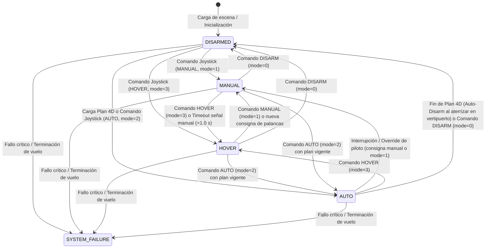

# Extensión NavSim - Consola para NVIDIA Isaac Sim

Guía técnica, arquitectura del motor de simulación y manual de usuario de la extensión **`navsim`** (**NavSim - Consola**) en NVIDIA Isaac Sim (Omniverse Kit).

---

## Ficha Técnica

| Parámetro | Detalle |
| :--- | :--- |
| **Identificador del Paquete** | `navsim` |
| **Título en Isaac Sim** | `NavSim - Consola` |
| **Versión** | `2.0.0` |
| **Categoría** | `Simulation` |
| **Desarrollador (UTC)** | Unidad de Transferencia de Conocimiento en Movilidad Aérea Avanzada Mediante Aeronaves No Tripuladas (**UCLM-UAS**) |
| **Protocolo de Comunicaciones** | MAVLink v2 sobre sockets UDP en modo SITL (*Software-In-The-Loop*) |
| **Puertos de Recepción (RX)** | `15000 + uav_idx` (consignas cinemáticas manuales y planes 4D de Taylor) |
| **Puertos de Transmisión (TX)** | `16000 + uav_idx` (telemetría continua ASTM F3411 y estado de misión) |
| **Estándares Soportados** | ASTM F3411-22a (Direct Remote ID), EUROCAE ED-282 (EASA U-space), OpenUSD |
| **Entorno de Ejecución** | NVIDIA Isaac Sim 4.0+ / Omniverse Kit |

---

## 1. Introducción y Propósito

La extensión **`NavSim - Consola`** (`navsim`) constituye el núcleo de simulación física vectorizada, inercial, temporal y de enlace de comunicaciones MAVLink v2 para flotas heterogéneas de aeronaves no tripuladas en **NVIDIA Isaac Sim**.


*Figura 1: Entorno de simulación en Isaac Sim con la ventana NavSim - Consola desplegada, mostrando los cuatro módulos operativos (Mapa, Tiempo, Flota y Comunicaciones).*

Su arquitectura reproduce con máxima fidelidad el gemelo digital de las aeronaves y su entorno operacional:
- **Simulación física y cinemática vectorizada**: Calcula la dinámica de vuelo en tiempo real mediante PhysX y `RigidPrim`, integrando fuerzas aerodinámicas, empuje de rotores y lecturas inerciales (IMU).
- **Comunicaciones estándar en red**: Cada aeronave se comunica de forma independiente con el exterior mediante el protocolo **MAVLink v2 sobre UDP** (*Software-In-The-Loop* / SITL), recibiendo planes de vuelo 4D o consignas de pilotaje manual y emitiendo telemetría continua.
- **Georreferenciación y Cronorreferenciación**: Vinculación matemática rigurosa con el elipsoide WGS-84 y con la escala de tiempo universal coordinado ($T_0$ UTC).

---

## 2. Requisitos de los Escenarios (Escenas USD)

Para que un escenario 3D en OpenUSD sea compatible con `navsim`, debe cumplir las siguientes especificaciones:

1. **Entorno Físico (`PhysicsScene`)**:
   - Debe contener un prim con el schema `PhysicsScene` (por ejemplo, en `/World/Environment/PhysicsScene` o `/PhysicsScene`).
   - Debe incluir colisionadores físicos en el terreno o suelo (malla o plano con `PhysicsCollisionAPI`).
   - Las unidades del escenario deben ser metros (`metersPerUnit = 1.0`) y el eje vertical Z hacia arriba (`upAxis = "Z"`).

2. **Aeronaves (Drones)**:
   - Cada dron se representa mediante un prim en el Stage de USD, sin requisitos de nombres ni rutas fijas en la jerarquía.
   - Cada aeronave debe instanciar un modelo de flota mediante un payload o referencia nativa de USD hacia un asset de `fleet/` (por ejemplo, `@../../fleet/UAM_aerotaxi/1_rb_model.usd@`).
   - Cada prim de dron debe contener los atributos de identificación y operador descritos en la [Sección 5](#5-identificación-de-los-drones-y-del-operador).

3. **Infraestructura (Vertipuertos y entorno)**:
   - Los vertipuertos, plataformas de aterrizaje y elementos urbanos se definen como geometría 3D pasiva con sus correspondientes colisionadores físicos.

---

## 3. Georreferenciación (Elipsoide WGS-84)

En NavSim, el espacio cartesiano de Isaac Sim $(X, Y, Z)$ corresponde a un **plano tangente local ENU (*East-North-Up*)** anclado a coordenadas geodésicas sobre el elipsoide **WGS-84**:
- $+X$: Eje horizontal hacia el **Este** (metros).
- $+Y$: Eje horizontal hacia el **Norte** (metros).
- $+Z$: Eje vertical hacia **Arriba** / Altura AGL (metros).


*Figura 2: Módulo Mapa en NavSim - Consola: configuración de coordenadas de origen WGS-84 y selección de orígenes USD o Campus de Albacete (UCLM).*

### Detección y Origen por Defecto
1. **Detección Automática**: Al abrir una escena, la extensión inspecciona el Stage buscando metadatos geoespaciales nativos:
   - Metadatos de Omniverse Geospatial (`omni:geospatial:wgs84:reference:referencePosition`).
   - Nodos de Cesium (`CesiumGeoreference`).
   - Atributos personalizados (`NavSim:georeference:latitude`, `longitude`, `altitude`).
2. **Origen por Defecto**: Si el escenario no define coordenadas propias, la extensión asigna automáticamente el origen en el **Campus Universitario de Albacete (UCLM - ESII / I3A)**:
   - **Latitud**: `38.981800° N`
   - **Longitud**: `-1.857000° W`
   - **Altitud elipsoidal (HAE)**: `686.00 m`
3. **Configuración en Vivo**: Desde la ventana gráfica de NavSim (`Window > NavSim > Consola`), el usuario puede visualizar y editar interactivamente estas coordenadas en cualquier momento mediante los campos numéricos o los botones `USD` y `Albacete`.

---

## 4. Cronorreferenciación (Tiempo Real UTC y Evolución Simulada)

De manera homóloga a la georreferenciación espacial (que ancla el origen cartesiano $0,0,0$ a una coordenada geodésica WGS-84), la **cronorreferenciación** ancla el instante inicial de la simulación ($t_{\text{sim}} = 0.0\text{ s}$) a una fecha y hora absoluta en tiempo universal coordinado ($T_0$ UTC).


*Figura 3: Módulo Tiempo en NavSim - Consola: sincronización de $T_0$ UTC con el reloj del sistema o metadatos de capa USD, con edición manual y validación sintáctica.*

### Evolución Temporal Basada en el Simulador
Durante la ejecución de la simulación, el tiempo real evoluciona en función del tiempo de simulación virtual acumulado:
$$T_{\text{real}}(t) = T_0 + t_{\text{sim}}$$

- **Independencia del rendimiento hardware**: Si la máquina anfitriona sufre caídas de tasa de cuadros (FPS) o la física se procesa más lenta que el tiempo de pared (*wall-clock*), la evolución temporal se mantiene numéricamente congruente e invariable según el tiempo simulado acumulado por PhysX.
- **Transmisión en Remote ID (ASTM F3411)**: El campo de timestamp de las tramas de identificación a distancia `OPEN_DRONE_ID_LOCATION` codifica con exactitud los segundos transcurridos dentro de la hora UTC actual:
  $$\text{timestamp}_{\text{ODID}} = (T_0 + t_{\text{sim}}) \pmod{3600.0}$$

### Fuentes de Tiempo, Ajuste y Sincronización USD
El panel **Tiempo** en la consola de NavSim (`Window > NavSim > Consola`) proporciona control integral de la ventana temporal y sincronización con el motor USD:
1. **Detectar desde USD (`USD`)**: Lee atributos `NavSim:time:datetime` o `NavSim:time:epoch` en el prim `/World` o en `customLayerData` del root layer USD.
2. **Restablecer al reloj del sistema (`Sistema (UTC)`)**: Sincroniza $T_0$ con el reloj de la máquina anfitriona en tiempo real UTC, truncando a segundos enteros para evitar desfases fraccionarios.
3. **Edición Manual Inicial y Final**: Campos de texto editables para `Fecha` (`AAAA-MM-DD`) y `Hora` (`HH:MM:SS`), dotados de validación automática que restaura el valor previo en caso de formato erróneo. El botón **`+1 hora`** incrementa acumulativamente la hora final de simulación.
4. **Calidad de Simulación (`TCPS`) y Capa Raíz USD**: El campo numérico editable `TCPS` (*Time Codes Per Second*) sincroniza directamente las propiedades temporales de la capa raíz del Stage USD:
   - `Start Time Code = 0.0`
   - `Time Codes Per Second = TCPS`
   - `End Time Code = Duración [s] * TCPS`
5. **Detención Automática y Protección de Estado**:
   - Al alcanzar el instante final programado, la simulación se pausa de forma limpia (`timeline.pause()`), permitiendo inspeccionar la posición final de las aeronaves en el escenario.
   - Mientras la simulación está en ejecución o pausada, el instante inicial queda bloqueado para evitar discontinuidades; por el contrario, el instante final puede extenderse en cualquier momento (mediante `+1 hora` o indicando una fecha/hora futura), permitiendo reanudar la marcha con el botón `Play`.

---

## 5. Identificación de los Drones y del Operador

Cada dron en la escena USD se parametriza a través de atributos bajo el espacio de nombres `NavSim:`. La extensión inspecciona el Stage y reconoce automáticamente las aeronaves a partir de estos atributos, asegurando la conformidad con las normativas internacionales de identificación a distancia **ASTM F3411-22a** (FAA / Direct Remote ID) y **EUROCAE ED-282** (EASA U-Space / Network & Direct Remote ID).


*Figura 4: Módulo Flota en NavSim - Consola: resumen de conformidad legal de la flota e inspector pormenorizado de atributos de aeronave y puertos MAVLink asignados.*

### Lista de Atributos NavSim en USD

| Atributo USD | Tipo | Presencia | Valor por defecto | Descripción | Ejemplo / Valores |
| :--- | :--- | :---: | :---: | :--- | :--- |
| `NavSim:id` | `string` / `token` | **Obligatorio** | — | Identificador oficial único de la aeronave (`uas_id`). Debe ser único en la flota. | `"UAV_01"`, `"Dron_02"` |
| `NavSim:id_type` | `int` | **Obligatorio** | — | Tipo de identificador UAS según norma ASTM F3411. | `1` (Nº Serie ANSI/CTA-2063-A), `2` (CAA), `3` (UUID UTM), `4` (Sesión) |
| `NavSim:ua_type` | `int` | **Obligatorio** | — | Categoría de aeronave según norma ASTM F3411. | `1` (Ala fija), `2` (Multirrotor), `4` (VTOL híbrido) |
| `NavSim:operator_id` | `string` | **Obligatorio** | — | Matrícula o registro oficial del operador civil ante la autoridad aeronáutica (AESA, FAA, EASA). | `"ESP-OP-1234567890ab"` |
| `NavSim:operator_id_type`| `int` | *Opcional* | `0` | Tipo de operador según ASTM F3411. Por defecto `0` (Operador registrado ante autoridad de aviación civil - CAA). | `0` (CAA) |
| `NavSim:self_id_desc` | `string` | *Opcional* | `""` *(vacío)* | Descripción textual del rol o estado en reposo (máx. 23 caracteres). Si se omite, la telemetría emite una cadena vacía en reposo. | `"Aerotaxi Urbano"`, `""` |

### Modelo Dinámico e Inercial
El modelo físico de vuelo y sus coeficientes de dinámica (`fleet/*/dynamics.yaml`) se determinan automáticamente a partir de la referencia o payload de USD que vincula el asset 3D en `fleet/`.

### Validación y Verificación al Iniciar la Simulación
Al pulsar **PLAY** en Isaac Sim (o mediante el botón *Refrescar* en la interfaz gráfica), la extensión ejecuta una comprobación integral de la flota:
1. **Atributos incompletos**: Si alguna aeronave carece de los atributos obligatorios, se muestra una notificación de advertencia en la consola y la interfaz visualiza el listado de campos faltantes.
2. **Conflicto de identificadores duplicados**: Si dos o más aeronaves comparten el mismo `NavSim:id`, la simulación se detiene de inmediato (`timeline.stop()`) para garantizar la seguridad operacional y evitar colisiones de telemetría.
3. **Inspector en vivo y Selección Dinámica**: El desplegable permite examinar individualmente cada aeronave, mostrando su prim USD, número de serie, modelo físico y puertos RX/TX asignados. Cuenta con:
   - **Botón `Enfocar`**: Selecciona y centra automáticamente la cámara del Viewport activo de Isaac Sim sobre el prim del UAV seleccionado.
   - **Refresco bajo demanda**: Al hacer clic sobre el desplegable, se comprueba en tiempo real el Stage USD y se actualiza la lista solo si hubo altas, bajas o renombrados de drones en la escena, preservando la selección actual siempre que sea posible.

---

## 6. Máquina de Estados Operativos de los Drones

Cada aeronave simulada en NavSim opera según una máquina de estados determinista y desacoplada, compatible tanto con el control autónomo por rutas 4D como con el pilotaje manual y la extensión **NavSim - Joystick**:



### 6.1. Definición de Estados Operativos

1. **`DISARMED` (Desarmado / En reposo)**:
   - **Condición**: Motores completamente apagados a 0 RPM ($\omega_i = 0$). Sin generación de sustentación, fuerzas ni momentos ($F = 0, \tau = 0$).
   - **Comportamiento físico**: Si la aeronave se encuentra en tierra, permanece estacionada. Si el comando `DISARM` se emite en pleno vuelo, la aeronave queda sujeta únicamente a la gravedad pura de Isaac Sim ($-9.81\text{ m/s}^2$), precipitándose al suelo en caída libre balística.
   - **Aviónica y Telemetría**: La electrónica de a bordo, el enlace de comunicaciones y la emisión de telemetría MAVLink **siguen plenamente operativos**, reportando estado `GROUND` o `EMERGENCY` según su altitud y velocidad.

2. **`MANUAL` (Control Manual Directo)**:
   - **Condición**: La aeronave responde directamente a las velocidades de avance, desplazamiento lateral, vertical y guiñada ($v_x, v_y, v_z, \dot{\psi}$) enviadas periódicamente por la extensión Joystick, teclado o GCS.
   - **Failsafe de enlace**: Si transcurre más de **1.0 segundo** sin recibir paquetes manuales, el sistema conmuta automáticamente a `HOVER` para evitar derivas o impactos por pérdida de señal.

3. **`HOVER` (Vuelo Estacionario Activo / Posición Fija)**:
   - **Condición**: La aeronave mantiene de forma activa su posición tridimensional $(x, y, z)$ y su orientación en el espacio.
   - **Actuación**: El controlador aplica el empuje de equilibrio necesario para compensar la gravedad ($\omega_i = \omega_{\text{hov}}$) y corrige cualquier perturbación aerodinámica o inercial, con velocidad de referencia nula ($\mathbf{v}_{\text{des}} = \mathbf{0}$).
   - **Activación**: Por botón explícito "Hover" del Joystick, por timeout de seguridad en manual, o al finalizar el último tramo de una misión 4D.

4. **`AUTO` (Guiado Autónomo por Ruta 4D de Taylor)**:
   - **Condición**: La aeronave ejecuta de forma autónoma una misión espacio-temporal basada en tramos de **polinomios de Taylor de grado 5**.
   - **Actuación**: En cada ciclo del lazo de física, el controlador evalúa la trayectoria continua de referencia $\mathbf{p}_{\text{Taylor}}(t)$ y $\mathbf{v}_{\text{Taylor}}(t)$, aplicando la ley de control lineal $u = H_s - K_x x - K_y E$ sobre los actuadores.
   - **Prioridad del piloto**: Cualquier acción manual del piloto (mover las palancas o pulsar "Manual") interrumpe inmediatamente el modo `AUTO` transfiriendo el control al piloto (`MANUAL`).
   - **Finalización de misión (Auto-Disarm)**: Dado que las rutas 4D de NavSim están calibradas con máxima precisión para depositar la aeronave directamente sobre la superficie del vertipuerto de destino con velocidad y aceleración nulas ($\mathbf{v}=\mathbf{0}, \mathbf{a}=\mathbf{0}$), al cumplirse el tiempo final del plan ($t \ge t_{\text{finish}}$) se ejecuta automáticamente el **Auto-Disarm**: corte total de motores a 0 RPM y transición al estado **`DISARMED`**, quedando la aeronave estacionada de forma estable sobre la plataforma por la física de gravedad y contacto de Isaac Sim.

5. **`SYSTEM_FAILURE` (Fallo de Sistema / Emergencia Crítica)**:
   - **Condición**: Pérdida irrecuperable de la integridad de la aeronave, fallo de sensores/actuadores, orden MAVLink de terminación de vuelo (`MAV_CMD_DO_FLIGHTTERMINATION`) o fallo crítico de Remote ID.
   - **Comportamiento**: La aeronave queda fuera de servicio operacional (*out of service*), se cortan los actuadores y se emite la trama de emergencia ASTM F3411 (`MavOdidStatus.REMOTE_ID_SYSTEM_FAILURE`).
   - **Alcance**: Un fallo de sistema puede ocurrir desde **cualquier estado** (`DISARMED`, `MANUAL`, `HOVER` o `AUTO`).

---

### 6.2. Aclaración Conceptual: `DISARM` frente a `SYSTEM_FAILURE`

| Criterio | `DISARM` (Desarmado / Corte de Motores) | `SYSTEM_FAILURE` (Fallo de Sistema / Emergencia) |
| :--- | :--- | :--- |
| **Naturaleza** | **Procedimiento operacional normal** (antes de despegar, tras aterrizar o corte intencional de motores). | **Condición anómala o fallo catastrófico** de hardware, software o seguridad operacional. |
| **Estado de Aviónica** | **Operativa**: Responde a comandos MAVLink y puede volver a armarse (`MANUAL`, `HOVER` o `AUTO`). | **Bloqueada / Fuera de servicio**: Requiere reinicio o intervención técnica. |
| **Motores / Actuadores** | Velocidad de giro anulada a 0 RPM ($\omega_i = 0$). | Apagado de emergencia o inoperativos. |
| **Telemetría ASTM F3411** | `GROUND` (si está en vertipuerto/suelo) o `EMERGENCY` (si cae en el aire). | `REMOTE_ID_SYSTEM_FAILURE` / `EMERGENCY`. |

---

### 6.3. Interacción con la Extensión "NavSim - Joystick"

La máquina de estados coincide de forma unívoca (1:1) con los 4 botones de vuelo de la interfaz del Joystick:

| Botón Joystick | Código MAVLink (`mode`) | Transición en la Máquina de Estados | Comportamiento en Vuelo |
| :---: | :---: | :--- | :--- |
| **Manual** | `1` | Transición al estado **`MANUAL`** | El dron obedece las palancas de mando (velocidades $v_x, v_y, v_z, \dot{\psi}$). |
| **Hover** | `3` | Transición al estado **`HOVER`** | Frena de inmediato y mantiene posición y altitud fijas con sustentación activa. |
| **Auto** | `2` | Transición al estado **`AUTO`** | Reanuda o ejecuta la trayectoria 4D de Taylor si existe un plan cargado. |
| **Disarm** | `0` | Transición al estado **`DISARMED`** | Corte inmediato de motores a 0 RPM; si vuela, cae por gravedad al suelo. |

---

## 7. Recepción de Órdenes: Rutas 4D y Control Manual

Cada aeronave simulada dispone de un puerto UDP exclusivo de recepción de comandos (**RX: `15000 + idx`**, donde `idx = 0, 1, ..., N-1` según el índice de la aeronave en la flota).

### 7.1. Modo Automático: Rutas 4D con Polinomios de Taylor de Grado 5

Las trayectorias en NavSim son continuas en 4 dimensiones $(x, y, z, t)$, definidas por tramos polinómicos de Taylor hasta la 5ª derivada:

$$\mathbf{p}(t) = \mathbf{p}_k + \mathbf{v}_k \Delta t + \frac{1}{2} \mathbf{a}_k \Delta t^2 + \frac{1}{6} \mathbf{j}_k \Delta t^3 + \frac{1}{24} \mathbf{s}_k \Delta t^4 + \frac{1}{120} \mathbf{c}_k \Delta t^5$$

$$\mathbf{v}(t) = \mathbf{v}_k + \mathbf{a}_k \Delta t + \frac{1}{2} \mathbf{j}_k \Delta t^2 + \frac{1}{6} \mathbf{s}_k \Delta t^3 + \frac{1}{24} \mathbf{c}_k \Delta t^4$$

Donde $\Delta t = t - t_k$, siendo $\mathbf{p}_k$ la posición, $\mathbf{v}_k$ la velocidad, $\mathbf{a}_k$ la aceleración, $\mathbf{j}_k$ el *jerk*, $\mathbf{s}_k$ el *snap* y $\mathbf{c}_k$ el *crackle*.

#### Flujo de Carga de Rutas:
1. El emisor envía un mensaje `NAVSIM_FLIGHT_PLAN_HEADER` (**ID 12000**) indicando el identificador del plan (`plan_id`), prioridad, radios y el número total de waypoints (`num_waypoints`).
2. A continuación, envía secuencialmente los mensajes `NAVSIM_FLIGHT_PLAN_WAYPOINT` (**ID 12001**) de cada tramo (`seq = 0 .. num_waypoints-1`).
3. Al recibir el último tramo, la aeronave valida la integridad del plan, responde con un mensaje `NAVSIM_FLIGHT_PLAN_ACK` (**ID 12002**, resultado `ACCEPTED = 0`) y activa automáticamente el modo `BUSY` al alcanzarse el tiempo inicial $t_{\text{init}}$.

### 7.2. Modo Manual: Consignas Cinemáticas Directas

Para el pilotaje manual directo se envían paquetes `NAVSIM_MANUAL_CONTROL` (**ID 12004**) al puerto `15000 + idx`:
- `vel_x`, `vel_y`, `vel_z`: Velocidades lineales deseadas en el marco cuerpo de la aeronave ($\text{m/s}$).
- `rot_z`: Velocidad angular de guiñada (*yaw rate*) en $\text{rad/s}$.
- `mode`: Modo solicitado (`0=DISARM/IDLE`, `1=MANUAL`, `2=AUTO`, `3=HOVER`).

---

## 8. Emisión de Telemetría: MAVLink v2 y Mensajes Salientes

Cada aeronave emite continuamente su telemetría a **1.0 Hz** por defecto (tasa estándar reglamentaria de Remote ID ASTM F3411 / EUROCAE ED-282, configurable dinámicamente desde 0.1 Hz hasta 100 Hz desde la Consola) a través de su puerto dedicado (**TX: `16000 + idx`**) hacia `127.0.0.1:(16000 + idx)`.


*Figura 5: Módulo Comunicaciones en NavSim - Consola: estado de sockets UDP, frecuencia de telemetría en vivo y rangos de puertos abiertos para la flota.*

### 8.1. Implementación del Protocolo MAVLink v2

La extensión cuenta con un códec nativo de MAVLink v2:
- **Cabecera MAVLink v2**: Identificador `0xFD`, longitud y contadores de secuencia estándar.
- **Direccionamiento**: `sysid = (idx % 254) + 1`, `compid = 1`.
- **Integridad**: Verificación mediante suma de comprobación estándar `X.25 CRC-16/MCRF4XX` con semilla `CRC_EXTRA` por tipo de mensaje.

### 8.2. Contenido del Datagrama de Telemetría

En cada ciclo de emisión, el datagrama emitido por cada aeronave contiene **5 tramas MAVLink v2**:

```
+---------------------------------------------------------------------------------------------------+
| Datagrama UDP Saliente (Puerto 16000 + idx)                                                      |
+---------------------------------------------------------------------------------------------------+
| [1] OPEN_DRONE_ID_LOCATION    (ID 12901, 59B) -> Cinemática geodésica WGS-84 y vector polar      |
| [2] OPEN_DRONE_ID_BASIC_ID    (ID 12900, 44B) -> Identificación oficial UAS (UAS ID)              |
| [3] OPEN_DRONE_ID_OPERATOR_ID (ID 12905, 43B) -> Registro CAA de operador civil                  |
| [4] OPEN_DRONE_ID_SELF_ID     (ID 12903, 46B) -> Descripción del propósito de vuelo / operación   |
| [5] NAVSIM_FLIGHT_PLAN_STATUS (ID 12003, 125B)-> Estado de ruta 4D y seguimiento del polinomio   |
+---------------------------------------------------------------------------------------------------+
```

#### 1. Tramas de Identificación y Cinemática (ASTM F3411 / EUROCAE ED-282):
- **`OPEN_DRONE_ID_LOCATION` (ID 12901)**:
  - `latitude`, `longitude`: Coordenadas WGS-84 en grados $\times 10^7$.
  - `altitude_geodetic`: Altitud elipsoidal HAE en metros.
  - `height`: Altura AGL sobre el terreno o vertipuerto en metros.
  - `speed_horizontal`: Velocidad horizontal en $\text{cm/s}$.
  - `speed_vertical`: Velocidad vertical en $\text{cm/s}$ (+ ascenso, - descenso).
  - `direction`: Rumbo (*track angle*) en centígrados ($0..35999$).
  - `status`: Estado de vuelo (`1=GROUND`, `2=AIRBORNE`, `4=FAILURE`).
- **`OPEN_DRONE_ID_BASIC_ID` (ID 12900)**: Número de serie o identificador legal `uas_id` y categoría `ua_type`.
- **`OPEN_DRONE_ID_OPERATOR_ID` (ID 12905)**: Matrícula oficial de operador civil y tipo.
- **`OPEN_DRONE_ID_SELF_ID` (ID 12903)**: Descripción dinámica de la operación en curso:
  - En misión activa (`BUSY`): emite el identificador de ruta/misión (`"Mision: <plan_id>"`).
  - En control manual (`MANUAL`): emite `"Control Manual"`.
  - En fallo o emergencia (`DEAD`): emite `"EMERGENCY / FAILURE"` con `description_type = 1`.
  - En reposo (`IDLE`): emite `NavSim:self_id_desc` si fue configurado en el Prim, o una cadena vacía `""` en caso contrario.

#### 2. Telemetría de Ruta 4D y Polinomio de Taylor:
- **`NAVSIM_FLIGHT_PLAN_STATUS` (ID 12003, `CRC_EXTRA = 221`, 125 bytes)**:
  Proporciona información en tiempo real sobre el seguimiento de la trayectoria 4D planificada:
  - `time_unix_usec` (`uint64`, µs): Instante UTC actual de simulación, en microsegundos desde 1970-01-01 00:00:00 UTC.
  - `sim_time` (`float`, s): Tiempo actual de simulación.
  - `uav_state` (`uint8`): Estado operativo (`0=IDLE`, `1=BUSY`, `2=DEAD`, `3=MANUAL`).
  - `plan_id` (`char[32]`): Identificador de la ruta 4D activa.
  - `current_wp` (`int16`): Índice del tramo polinómico activo.
  - `total_wps` (`uint16`): Número total de waypoints del plan.
  - `wp_label` (`char[16]`): Etiqueta identificativa del waypoint en curso.
  - `fp_init_time`, `fp_finish_time` (`float`, s): Ventana temporal del plan de vuelo.
  - `wp_time` (`float`, s): Instante de referencia $t_k$ del tramo actual.
  - `desired_pos` (`float[3]`, m): Posición 3D teórica calculada por el polinomio en ese instante.
  - `desired_vel` (`float[3]`, m/s): Velocidad 3D teórica calculada por el polinomio en ese instante.
  - `pos_error` (`float[3]`, m): Error instantáneo de posición $\mathbf{p}(t) - \mathbf{p}_{\text{Taylor}}(t)$.
  - `vel_error` (`float[3]`, m/s): Error instantáneo de velocidad $\mathbf{v}(t) - \mathbf{v}_{\text{Taylor}}(t)$.

#### 3. Soporte para Estaciones y Monitores Remotos:
NavSim registra dinámicamente las direcciones IP de origen de cualquier datagrama recibido en los puertos de comandos RX (`15000 + ID`), incorporándolas a los destinos de emisión continua de telemetría TX (`16000 + ID`). Esto permite desplegar aplicaciones de monitorización externa (como `telemetry_monitor.py` o GCS) en otras máquinas de la red sin necesidad de reconfigurar puertos fijos en el simulador.

---

## 9. Catálogo de Mensajes MAVLink v2 de NavSim

| ID Mensaje | Nombre en Dialecto | Dirección | Tamaño Payload | Finalidad Principal |
| :---: | :--- | :---: | :---: | :--- |
| **`12000`** | `NAVSIM_FLIGHT_PLAN_HEADER` | RX (Entrante) | 54 bytes | Cabecera y metadatos de ruta 4D polinómica. |
| **`12001`** | `NAVSIM_FLIGHT_PLAN_WAYPOINT`| RX (Entrante) | 137 bytes | Coeficientes del polinomio de Taylor de grado 5 (hasta la 5ª derivada `crackle`). |
| **`12002`** | `NAVSIM_FLIGHT_PLAN_ACK` | TX (Saliente) | 37 bytes | Acuse de recibo y validación de carga del plan de vuelo. |
| **`12003`** | `NAVSIM_FLIGHT_PLAN_STATUS` | TX (Saliente) | 125 bytes | Progreso de ruta 4D y error de seguimiento respecto al polinomio de Taylor. |
| **`12004`** | `NAVSIM_MANUAL_CONTROL` | RX (Entrante) | 22 bytes | Consignas cinemáticas directas ($v_x, v_y, v_z, \dot{\psi}$) y modo. |
| **`12900`** | `OPEN_DRONE_ID_BASIC_ID` | TX (Saliente) | 44 bytes | Estándar ASTM F3411: Identificación oficial UAS. |
| **`12901`** | `OPEN_DRONE_ID_LOCATION` | TX (Saliente) | 59 bytes | Estándar ASTM F3411: Posición WGS-84, alturas y velocidades polares. |
| **`12903`** | `OPEN_DRONE_ID_SELF_ID` | TX (Saliente) | 46 bytes | Estándar ASTM F3411: Propósito / descripción de la operación. |
| **`12905`** | `OPEN_DRONE_ID_OPERATOR_ID` | TX (Saliente) | 43 bytes | Estándar ASTM F3411: Registro oficial de operador CAA. |

---

## 10. Guía de Uso Rápido

1. **Cargar Escenario en Isaac Sim**:
   Abrir una escena (por ejemplo, `sims/100_aerotaxi/scene.usd` o `sims/navsim/main_scene.usd`).
2. **Abrir la Interfaz de NavSim**:
   En el menú superior de Isaac Sim: `Window > NavSim > Consola`.
3. **Verificar Georreferenciación, Tiempo y Flota**:
   - **Mapa**: Comprobar que las coordenadas WGS-84 se ajustan al entorno deseado (o pulsar *Albacete*).
   - **Tiempo**: Comprobar la fecha y hora UTC inicial $T_0$ (desde reloj del sistema, USD o manual).
   - **Flota**: Comprobar el panel de validación de aeronaves (estado verde `OK`) y seleccionar aeronaves en el desplegable.
   - **Comunicaciones**: Verificar la frecuencia deseada de telemetría y los rangos de puertos asignados.
4. **Iniciar Simulación**:
   Pulsar el botón **PLAY** en la barra de herramientas de Isaac Sim. La simulación inicializa la dinámica física y abre los puertos de red MAVLink UDP.
5. **Monitorizar Telemetría**:
   En una terminal externa, ejecutar:
   ```powershell
   python scripts/telemetry_monitor/telemetry_monitor.py
   ```
6. **Enviar Consignas**:
   - Vía manual: Abrir la extensión `manual_controller` (`Window > NavSim > Joystick`) para pilotar mediante teclado o mando/gamepad.
   - Vía automática: Transmitir planes de vuelo polinómicos por MAVLink v2 hacia los puertos RX `15000 + idx`.
